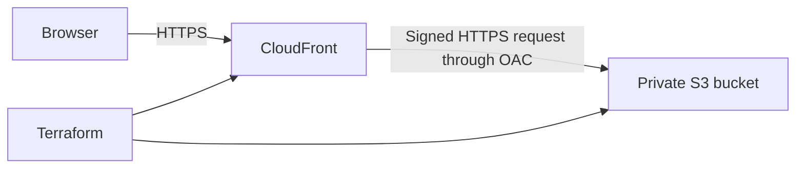

# infra-eng-challenge

A small static website on AWS, provisioned with Terraform. The page displays
"This is Charlie Magnarelli's website."

**Status:** Terraform validation and an authenticated AWS plan have passed.
Deployment, live checks, and author review remain outstanding. This repository
records completed checks separately from proposed production improvements.

## Approach



S3 stores a single HTML file. CloudFront supplies a public HTTPS endpoint using
its default domain and certificate. Origin Access Control (OAC) permits the
specific distribution to read the file while S3 Block Public Access stays on.
The origin uses S3's REST endpoint; S3 website hosting is deliberately disabled
because website endpoints do not support OAC.

This is enough infrastructure for a static page without running servers or a
container platform. Terraform manages both the infrastructure and the small page
so a fresh deployment is reproducible from this repository.

`PriceClass_100` favors delivery cost by restricting the edge locations used;
it does not geographically restrict visitors. Revisit this choice against the
actual audience and latency needs.

| Requirement | How it is addressed |
| --- | --- |
| AWS website with static text and the author's name | HTML template in `site/`; name set through `site_owner` |
| Public repository with reproducible instructions | This README, Terraform files, example inputs, and dependency lock file |
| Explain further work | [With more time](#with-more-time) |
| Explain alternatives | [Alternatives considered](#alternatives-considered) |
| Describe production operation across teams | [Production and multiple development teams](#production-and-multiple-development-teams) |
| Explain AI assistance | [AI use](#ai-use) |

The public repository is the submission artifact. Its name, description, and
tracked contents must remain neutral; the supplied exercise and job posting
are kept outside the repository.

The exercise has a three-hour limit. During implementation, the author reported
approximately 30-60 minutes of personal effort so far. That is an interim
self-report, not a measured final total. Deployment and the required explanations
take priority over additional features.

The engineering approach emphasizes three qualities:

| Quality | Concrete evidence |
| --- | --- |
| Reduce repeated effort | Terraform provisions content and infrastructure; deployment and cleanup commands are documented |
| Anticipate problems and give fast feedback | Expected-account checks, input validation, short cache lifetimes, CI validation, and troubleshooting guidance |
| Take pride in maintainable work | Small configuration, readable policies, reproducible dependency versions, and accurate verification results |

## Repository layout

```text
infra/                  Terraform root module and example inputs
site/index.html.tftpl    Minimal page; Terraform substitutes the author's name
README.md               Architecture, deployment, checks, and tradeoffs
.github/workflows/      Credential-free Terraform validation
```

## Prerequisites

- An AWS account with permission to manage S3 buckets and objects, bucket
  settings and policies, and CloudFront distributions, OACs, cache policies,
  response headers policies, and their tags. Read/update/delete permissions are
  needed for Terraform refresh and cleanup as well as creation. Organization
  policies must permit these services. This project does not create IAM roles.
- AWS CLI v2 with a working short-lived session, for example through your
  existing IAM Identity Center profile or `aws login`. Do not use the root user.
- Terraform CLI 1.10 or later, below 2.0. Use the committed provider lock file.
- Git and curl. The examples below use a POSIX shell.

On macOS, install Terraform using the
[official installation instructions](https://developer.hashicorp.com/terraform/install):

```sh
brew tap hashicorp/tap
brew install hashicorp/tap/terraform
```

This project uses the standard commercial AWS partition and defaults to
`us-east-1` for S3. CloudFront is global. No custom domain is required.

Create or obtain your deployment identity separately from this Terraform root.
A dedicated console-only IAM deployment user has been created in the author's
account and the reviewed deployment policy has been attached. Password/MFA
setup and named-profile login remain outstanding. Browser sign-in provides
temporary credentials without access keys.
Another reader can use their existing suitably authorized identity. The website
stack does not create or delete its operator's access.

The [deployment policy example](infra/deployment-policy.example.json) documents
the operator's permissions; committing a policy file does not attach it in AWS.
It contains a placeholder account ID and no credentials. Review and adapt it
before use. S3 access is limited to project-prefixed buckets and `index.html`;
distribution access requires the project tag. CloudFront's three configuration
create actions require wildcard resources, and configuration management is
initially scoped to the target account. Narrow it to the created configuration
IDs after deployment. IAM administration is excluded; the separate
`SignInLocalDevelopmentAccess` managed policy permits browser-based CLI login.

## Deploy

1. Clone the repository and confirm your AWS identity:

   ```sh
   git clone https://github.com/charliemags/infra-eng-challenge.git
   cd infra-eng-challenge
   # Select your own authorized profile before continuing:
   export AWS_PROFILE=your-profile
   aws sts get-caller-identity
   ```

   Complete your normal AWS login first if this command fails. Check the
   account ID and role in the result; do not paste credentials into this repo.

2. Copy and edit the inputs:

   ```sh
   cp infra/terraform.tfvars.example infra/terraform.tfvars
   ```

   Set `aws_account_id` to the account returned above. The provider checks it to
   help prevent deploying into the wrong account. `site_owner` is already set
   to Charlie Magnarelli in the example; another reader can substitute their
   own name. The generated bucket name receives a unique suffix automatically.

3. Initialize, check, and review a plan:

   ```sh
   terraform -chdir=infra init
   terraform -chdir=infra fmt -check
   terraform -chdir=infra validate
   terraform -chdir=infra plan -out=tfplan
   ```

   The initial plan should contain ten resources to add, with no changes or
   deletions. Review the target account, region, resources, and expected charges before
   applying. The plan and state are local, ignored files. The dependency lock
   file is committed; update it deliberately when upgrading the provider.

4. Deploy the reviewed plan:

   ```sh
   terraform -chdir=infra apply tfplan
   terraform -chdir=infra output -raw website_url
   ```

   CloudFront propagation can take several minutes. Terraform waits for the
   distribution to deploy. Keep the terminal running and preserve local state.

## Verify

Run these checks after the apply completes:

```sh
site_url="$(terraform -chdir=infra output -raw website_url)"
origin_url="$(terraform -chdir=infra output -raw origin_object_url)"

curl --fail --show-error "$site_url"
curl --head "$site_url"
curl --head "http://${site_url#https://}"
curl --silent --output /dev/null --write-out '%{http_code}\n' "$origin_url"
terraform -chdir=infra plan -detailed-exitcode
```

Expected results:

- HTTPS returns HTTP 200 and the configured author's name. Open the URL in a
  browser too.
- Security headers include `strict-transport-security`, `content-security-policy`,
  `x-content-type-options`, and `x-frame-options`.
- HTTP redirects to HTTPS (normally 301).
- An anonymous request directly to the S3 object returns 403.
- A second Terraform plan exits 0 with no changes. Exit 2 means there is a diff;
  exit 1 indicates an error.

`validate` checks configuration and provider schema; it does not prove AWS
permissions, service acceptance, or live behavior. Record the actual deployment
URL, tool versions, date, and results here after performing these checks. Do not
commit state or raw plan files as evidence.

Local verification on November 24, 2026 used Terraform 1.17.2 and the signed AWS
provider 6.74.0. Formatting and schema validation passed. Evaluating the real
Terraform template confirmed the supplied name and HTML escaping. Git ignore
rules were checked for inputs, plans, state, and downloaded providers. An
authenticated AWS plan completed successfully: 10 resources to add, 0 to change,
and 0 to destroy. No apply, live HTTP checks, or destroy has been performed yet.

A clean checkout of the committed source also passed formatting, locked provider
initialization, schema validation, and an authenticated plan with the same ten
additions. It received its own local inputs and was not applied, so it created
no duplicate infrastructure. IAM policy simulation allowed the project page
while denying unrelated S3 writes, IAM administration, and distribution creation
without the project tag. Simulation is a configuration check, not proof that
every deployment API call will succeed.

The [Ubuntu CI run](https://github.com/charliemags/infra-eng-challenge/actions/runs/45525838751)
passed formatting, locked provider initialization, and schema validation after
the Linux checksum fix. Live website checks remain pending deployment.

## Continuous validation

[Terraform validation](https://github.com/charliemags/infra-eng-challenge/actions/workflows/terraform.yml)
runs on pull requests, pushes to `main`, and manual dispatch. It checks formatting,
initializes the locked provider without a backend, and validates configuration.
The Ubuntu runner uses Terraform 1.17.2; both setup actions are pinned to release
commit hashes, and the lock file includes explicit macOS ARM64 and Linux AMD64
provider checksums. The workflow has only repository-content read permission and no
AWS credentials. It does not prove deployment permissions or live behavior.

Deployment remains a manual operation using a reviewed saved plan. The public
workflow never receives state, account inputs, or the operator's credentials.

## Change the page

Edit `site/index.html.tftpl` or change `site_owner` in your local inputs, then
create and apply a new plan. Terraform updates the object when rendered content
changes. Names are escaped before being inserted into HTML.

The page uses a short, 60-second cache lifetime. Existing edge or browser caches
can briefly show the previous version. If an immediate edge refresh is needed:

```sh
aws cloudfront create-invalidation \
  --distribution-id "$(terraform -chdir=infra output -raw distribution_id)" \
  --paths /index.html /
```

Invalidations require an additional permission and may incur charges. They do
not clear an existing browser cache.

## Cost and cleanup

This deployment uses ordinary service billing rather than enrolling in a paid
subscription. S3 storage/requests and CloudFront requests/data transfer can incur
charges. Traffic, region, and account-specific credits affect the bill; free
tier eligibility is not assumed. Check current
[S3 pricing](https://aws.amazon.com/s3/pricing/) and
[CloudFront pricing](https://aws.amazon.com/cloudfront/pricing/) for your account.
Set an account budget alert before publishing; alerts do not cap spending.

To remove only this deployment:

```sh
terraform -chdir=infra plan -destroy -out=destroy.tfplan
terraform -chdir=infra apply destroy.tfplan
```

Review the destroy plan. CloudFront must disable and propagate before deletion,
so cleanup can also take several minutes. The bucket refuses forced deletion:
if you manually added other objects, remove those deliberately before retrying.
Keep the state until cleanup succeeds. Keep the site available for review if
requested, and agree on its eventual removal.

## Troubleshooting

| Symptom | What to inspect |
| --- | --- |
| AWS credentials expired or wrong account | Renew the selected profile's session; rerun `aws sts get-caller-identity`; check `aws_account_id` |
| AccessDenied during Terraform | Check the exact denied action, selected role, permission boundary, and organization policies |
| CloudFront returns 403 | Confirm apply finished, `index.html` exists, OAC is attached with signing enabled, and the bucket policy matches this distribution; keep Block Public Access enabled |
| Old content appears | Wait for the short cache lifetime or invalidate `/` and `/index.html` |
| Missing file returns 403 | Expected for a private S3 origin without ListBucket access; this is not configured as an SPA |
| Bucket deletion fails | Check for objects added outside Terraform; do not empty unrelated buckets |

## Alternatives considered

| Option | Tradeoff and reason to defer |
| --- | --- |
| Public S3 website endpoint | Fewer components, but direct website access is HTTP and the origin cannot use OAC. Private S3 plus CloudFront provides a better access boundary and HTTPS. |
| Amplify Hosting | A good AWS-managed option for Git-based frontend builds and previews. This single file needs no build pipeline, and explicit Terraform resources make infrastructure behavior easy to inspect. |
| EC2 or a container on ECS | Useful when a process must execute server-side. For static text, introduces compute, runtime patching, and deployment work without a requirement for it. |
| EKS and GitOps | Appropriate for an existing Kubernetes platform and services with runtime needs. Cluster lifecycle, ingress, policy, and operating cost are disproportionate for this page. |
| CloudFormation or CDK | Valid AWS-native IaC choices. Terraform matches the chosen workflow; its explicit plans and state tradeoffs are documented here. |
| GCP storage and CDN | Also fits the workload. One implementation keeps the exercise focused. Portable HTML and documented platform interfaces provide a migration path without pretending Terraform makes cloud resources interchangeable. |

## With more time

First, exercise a complete rebuild and cleanup in a separate sandbox. Then extend
the existing validation workflow with secret scanning and an IaC security scan
with documented exceptions. Prioritize fixes
that improve delivery and operation before adding more services.

A custom domain would need DNS ownership, an ACM certificate in `us-east-1`, DNS
validation, a CloudFront alias, and an appropriate viewer TLS policy. Release
artifacts and the delivery workflow would come next. If product requirements
introduce APIs or authentication, assess those separately rather than treating
the public static page as an authenticated application.

## Production and multiple development teams

These are proposed improvements, not capabilities implemented by this starter.

| Area | Proposed approach and why |
| --- | --- |
| Ownership and asynchronous collaboration | Define a service owner, escalation path, CODEOWNERS, concise ADRs, and runbooks. Record decisions and operational handoffs so teams across time zones can work independently. |
| Self-service delivery | Publish a versioned Terraform module and a template repository with safe defaults. Expose a small interface for domain, environment, owner, and budget tags; give teams a documented onboarding path. Extract the module after there is a second real consumer. |
| Environment boundaries | Use separate AWS accounts for production and non-production, with separate state, roles, and deployment approvals. Restrict preview environments to non-production; expire them automatically and cap their cost. |
| Terraform state and change control | Bootstrap a private encrypted S3 state bucket with versioning, least-privilege access, and native S3 lockfiles. Serialize applies, review saved plans against the exact commit, and use scheduled drift detection. Keep state and plan output private because they can contain sensitive values. |
| CI/CD identity | Use GitHub Actions OIDC and temporary AWS roles with trust restricted to the repository and approved branch/environment. Separate content publishing from infrastructure administration. Untrusted pull requests get credential-free checks; production apply requires a protected environment. |
| Releases and rollback | Build the site once, scan and record its artifact digest, and promote the same artifact. Use immutable asset names, short-lived HTML caching, explicit invalidation, and a tested rollback to the previous artifact. Give one system ownership of content publishing to avoid Terraform and CI overwriting each other. |
| Automated verification | Run formatting, validation, IaC/security and secret checks on pull requests. In an isolated deployment, verify HTTPS, expected content, headers, HTTP redirect, origin denial, and a clean subsequent plan. Exercise destroy and rollback periodically. |
| Observability | Enable CloudFront access logs to a separate encrypted, private destination with retention limits. Add S3 access logging and targeted CloudTrail data events where useful for origin auditing; retain management events for infrastructure changes. Use CloudWatch error, request, and latency metrics plus synthetic HTTPS checks, with actionable alerts and a named responder. Avoid logging secrets or unnecessary personal data. |
| Security and abuse | Keep OAC, public-access blocking, TLS, and browser security headers. Add AWS WAF managed rules and rate-based limits appropriate to observed traffic, testing in Count mode before enforcement. Shield Standard supplies baseline network DDoS protection; assess advanced paid protection only against a concrete need. Restrict administrative access through federated identities, MFA, and least-privilege roles. |
| Reliability and recovery | Define availability SLOs and RTO/RPO with product owners. Start with managed regional S3 and global CloudFront; test restoration from versioned release artifacts. Add a replicated secondary origin and failover only if recovery targets justify the complexity, and test content consistency and failover behavior. |
| Cost and governance | Tag resources by service, owner, and environment. Apply account budgets and anomaly alerts, review storage and log retention, and measure request/transfer costs. A budget alert is a notification rather than a spending limit. |
| Workload portability | Keep site assets and release contracts portable while containing AWS details in the infrastructure layer. If an existing Kubernetes platform later becomes relevant for dynamic services, integrate with its supported ingress, identity, policy, observability, and GitOps patterns. Do not introduce a cluster solely to serve static text. |

For this small exercise, access logs, WAF, remote state, custom DNS, automated
deployment, and recovery automation are deferred. The default CloudFront
certificate uses the service's viewer TLS policy; choosing a stricter viewer
policy belongs with a custom domain and certificate. The resulting limitations are
local state owned by one operator, no automated request audit or alerting, manual
deployments, one regional origin, and no application-layer traffic filtering.

## AI use

Codex was asked to help interpret the requirements and job context, recommend a
basic AWS and Terraform approach, and prepare a reproducible local starter.
It reviewed AWS and Terraform documentation, drafted the implementation and this
README, ran the local checks recorded above, and generated an authenticated AWS
plan. The requested goal was a small static
site with clear deployment, cleanup, alternatives, and a production evolution
discussion. The author's name was clarified as Charlie Magnarelli.

Human direction clarified the name, selected the small validation workflow, and
repeatedly asked to keep the work focused on simple requirements and instructions.
That feedback kept the implementation to a static website and excluded a separate
interview document. The author's assessment was that AI was useful for
brainstorming, while the engineer remained responsible for deciding direction.
Additional limitations surfaced during implementation: the policy generator
included unrelated permissions, so its output needed review and narrowing before
attachment, and the first Linux CI run exposed a provider checksum mismatch that
the local checks did not catch. The factual assistance history does not imply that the author has
completed a personal code review or live verification; those steps remain
outstanding before submission.

## References

- [CloudFront origin access control](https://docs.aws.amazon.com/AmazonCloudFront/latest/DeveloperGuide/private-content-restricting-access-to-s3.html)
- [S3 security best practices](https://docs.aws.amazon.com/AmazonS3/latest/userguide/security-best-practices.html)
- [Terraform AWS CloudFront resource](https://registry.terraform.io/providers/hashicorp/aws/latest/docs/resources/cloudfront_distribution)
- [Terraform S3 state backend and locking](https://developer.hashicorp.com/terraform/language/backend/s3)
